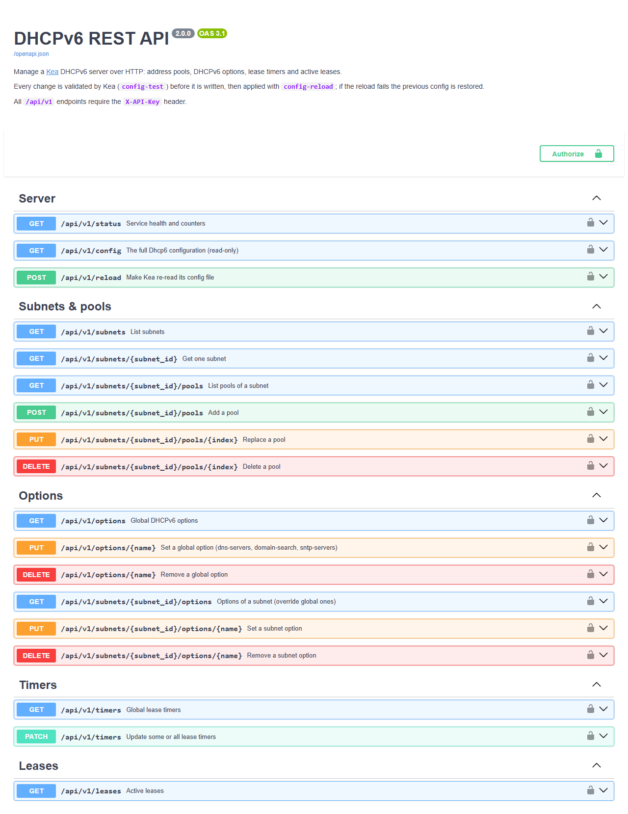
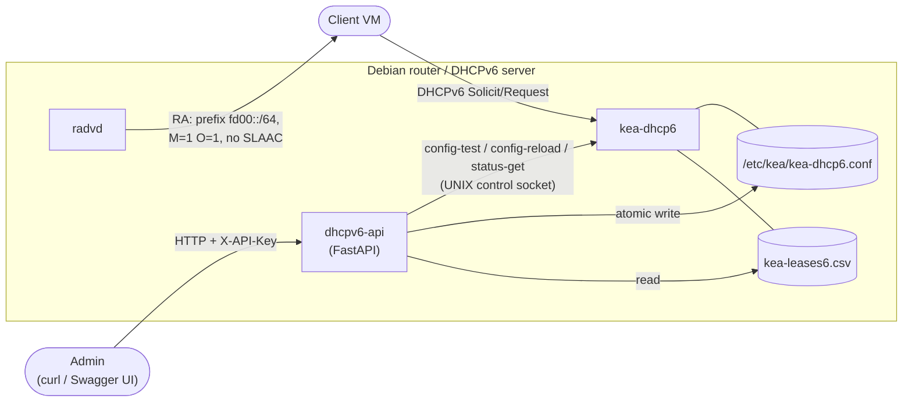

# dhcpv6-api

[](https://github.com/Jarru01/dhcpv6-api/actions/workflows/ci.yml)

A REST API for managing an [ISC Kea](https://www.isc.org/kea/) DHCPv6 server: address pools,
DHCPv6 options, lease timers and active leases. It ships with the network setup it was built
for: a Debian router on OpenStack that advertises an IPv6 prefix with **radvd** and assigns
addresses with **Kea** (stateful DHCPv6, no SLAAC).



## How it fits together



1. **radvd** advertises `fd00::/64` with the *Managed* and *Other* flags set and autonomous
   addressing off, so clients must ask DHCPv6 for both their address and their DNS settings.
2. **Kea** hands out addresses from the configured pools and keeps leases in a CSV file.
3. **dhcpv6-api** edits Kea's config and applies it to the running server through Kea's control
   socket, without restarting Kea.

## Safe config changes

Every write endpoint goes through the same steps (`ConfigManager.edit` in
[`kea.py`](src/dhcpv6_api/kea.py)):

1. Take a lock, so concurrent requests can't overwrite each other's changes.
2. Read and modify the config. Bad input is rejected early: pools must be valid IPv6 ranges
   inside the subnet and must not overlap, option values must be IPv6 addresses or domain names,
   and timers must satisfy `renew ≤ rebind ≤ preferred ≤ valid`.
3. Ask Kea to validate the new config with **`config-test`**. If Kea rejects it, nothing is
   written and the API returns `422` with Kea's error message.
4. Write the file atomically (temp file, `fsync`, `rename`), keeping its mode and group.
5. **`config-reload`**. If that fails, the previous file is restored and reloaded, and the API
   returns `502`.

## Quick start (Docker, no lab needed)

The demo image runs Kea 2.2 (Debian 12 package) and the API in one container. Kea doesn't
listen on any interface there, but the API talks to it over the real control socket.

```bash
docker compose up --build
```

Open <http://localhost:8000/docs>, click **Authorize**, and enter `demo-key-not-for-production`.
Or use curl:

```bash
KEY="X-API-Key: demo-key-not-for-production"

curl -H "$KEY" localhost:8000/api/v1/status
# {"kea_dhcp6":"active","kea_uptime_s":12,"radvd":"unknown","subnets":1,"active_leases":2}

curl -H "$KEY" -H "Content-Type: application/json" \
     -d '{"pool": "fd00::200 - fd00::2ff"}' localhost:8000/api/v1/subnets/1/pools
# {"index":1,"pool":"fd00::200 - fd00::2ff"}

curl -H "$KEY" -H "Content-Type: application/json" \
     -d '{"pool": "2001:db8::1 - 2001:db8::5"}' localhost:8000/api/v1/subnets/1/pools
# {"detail":"Pool 2001:db8::1 - 2001:db8::5 is not inside subnet fd00::/64"}

curl -X PUT -H "$KEY" -H "Content-Type: application/json" \
     -d '{"values": ["fd00::53"]}' localhost:8000/api/v1/options/dns-servers

curl -X PATCH -H "$KEY" -H "Content-Type: application/json" \
     -d '{"preferred_lifetime": 3600, "valid_lifetime": 7200}' localhost:8000/api/v1/timers
```

## API

All endpoints under `/api/v1` require the `X-API-Key` header. `GET /healthz` is public.

| Method | Path | Description |
| :-- | :-- | :-- |
| GET | `/status` | Kea state and uptime, radvd state, subnet and active-lease counts |
| GET | `/config` | Full `Dhcp6` configuration |
| POST | `/reload` | Make Kea re-read its config file (e.g. after a manual edit) |
| GET | `/subnets`, `/subnets/{id}` | Subnets with their pools and options |
| GET / POST | `/subnets/{id}/pools` | List / add pools (`"start - end"` or a prefix such as `fd00::300/120`) |
| PUT / DELETE | `/subnets/{id}/pools/{index}` | Replace / delete a pool |
| GET | `/options`, `/subnets/{id}/options` | Global / subnet-level DHCPv6 options |
| PUT / DELETE | `/options/{name}`, `/subnets/{id}/options/{name}` | Set / remove `dns-servers` (23), `domain-search` (24), `sntp-servers` (31) |
| GET / PATCH | `/timers` | Lease timers (T1, T2, preferred and valid lifetime) |
| GET | `/leases?subnet_id=` | Active leases |

Errors: `401` bad API key · `404` unknown subnet, pool index or option · `409` overlapping pool ·
`422` invalid input or config rejected by Kea · `502` Kea failed to reload (change rolled back) ·
`503` Kea control socket unreachable (nothing written).

## Lab deployment

[`deploy/avs-template.yaml`](deploy/avs-template.yaml) is an OpenStack Heat template that
creates the lab: a router/server with an external port (`ens3`) and a private network
`192.168.1.0/24` (`ens4`), plus one client. Access is by SSH key only (`ssh_public_key`
parameter), and the API port is only open on the private side. Reach it with an SSH tunnel:
`ssh -L 8000:localhost:8000 avs@<server>`.

Copy the configs into place on the server:

| Repo path | Target |
| :-- | :-- |
| `config/kea-dhcp6.conf` | `/etc/kea/kea-dhcp6.conf` |
| `config/radvd.conf` | `/etc/radvd.conf` |
| `config/99-ipv6.conf` | `/etc/sysctl.d/99-ipv6.conf` |
| `config/netplan/51-ipv6-SERVER.yaml` | `/etc/netplan/` on the server |
| `config/netplan/51-ipv6-CLIENT.yaml` | `/etc/netplan/` on the client |
| `deploy/dhcpv6-api.service` | `/etc/systemd/system/` |
| `.env.example` | `/etc/dhcpv6-api.env` (set a real key, `chmod 600`) |

Install the API:

```bash
sudo apt install kea-dhcp6-server radvd python3-venv
sudo install -d -o avs -g avs /opt/dhcpv6-api
git clone https://github.com/Jarru01/dhcpv6-api /opt/dhcpv6-api
python3 -m venv /opt/dhcpv6-api/venv && /opt/dhcpv6-api/venv/bin/pip install /opt/dhcpv6-api
```

The service runs as `avs` with the supplementary group `_kea`. That group needs write access
to the config file and its directory, because the atomic write creates a temp file next to it:

```bash
sudo chgrp _kea /etc/kea /etc/kea/kea-dhcp6.conf
sudo chmod 2775 /etc/kea && sudo chmod 664 /etc/kea/kea-dhcp6.conf
sudo systemctl daemon-reload && sudo systemctl enable --now dhcpv6-api
```

## Lessons learned

Problems from building the lab that cost the most time:

- **radvd stops sending RAs silently if the MTU is wrong.** OpenStack VXLAN networks use an
  MTU of 1442. With `AdvLinkMTU 1500`, radvd stops advertising and logs nothing, so clients get
  no prefix and no gateway. Check `ip link show ens4` and advertise the real MTU.
- **IPv6 forwarding turns off RA processing.** With `net.ipv6.conf.all.forwarding = 1`, the
  kernel ignores Router Advertisements on an interface unless its `accept_ra` is `2`.
- **`Requires=` vs `Wants=`.** With `Requires=kea-dhcp6-server.service`, restarting Kea from
  inside the API also stopped the API, killing the request that caused the restart. `Wants=`
  keeps the ordering without tying the two lifecycles together.
- **systemd has no trailing comments.** In `User=avs  # comment`, the comment becomes part of
  the user name. Comments must be on their own line (`systemd-analyze verify` catches this).
- **Kea 2.2 doesn't support the `ntp-server` option (56).** Using it makes the config fail to
  load, so the API sets `sntp-servers` (31) instead.
- **Kea's lease file is append-only.** Every renewal adds a row; only the last row for an
  address is current until Kea's LFC compacts the file. Counting rows overcounts leases.
- **Kea config files allow comments; JSON doesn't.** The API strips `//`, `/* */` and `#`
  comments before parsing. Files written by the API are plain JSON.

## Development

```bash
python -m venv .venv && . .venv/bin/activate
pip install -e ".[dev]"
pytest
ruff check . && ruff format --check .
```

Tests run against a fake Kea control socket and temp copies of the real config. CI also
validates both Kea configs with `kea-dhcp6 -t` and smoke-tests the Docker demo.

## Limitations

- Leases are read from the memfile CSV directly. Kea's `lease_cmds` hook (`lease6-get-all`)
  would be the way to support MySQL/PostgreSQL lease databases.
- Pools are addressed by list index, which shifts after a delete.
- No TLS. Keep the API on the private network or behind an SSH tunnel or reverse proxy.
- Comments in `kea-dhcp6.conf` are lost after the first change made through the API. The
  annotated version in this repo is the reference.

## License

[MIT](LICENSE)
